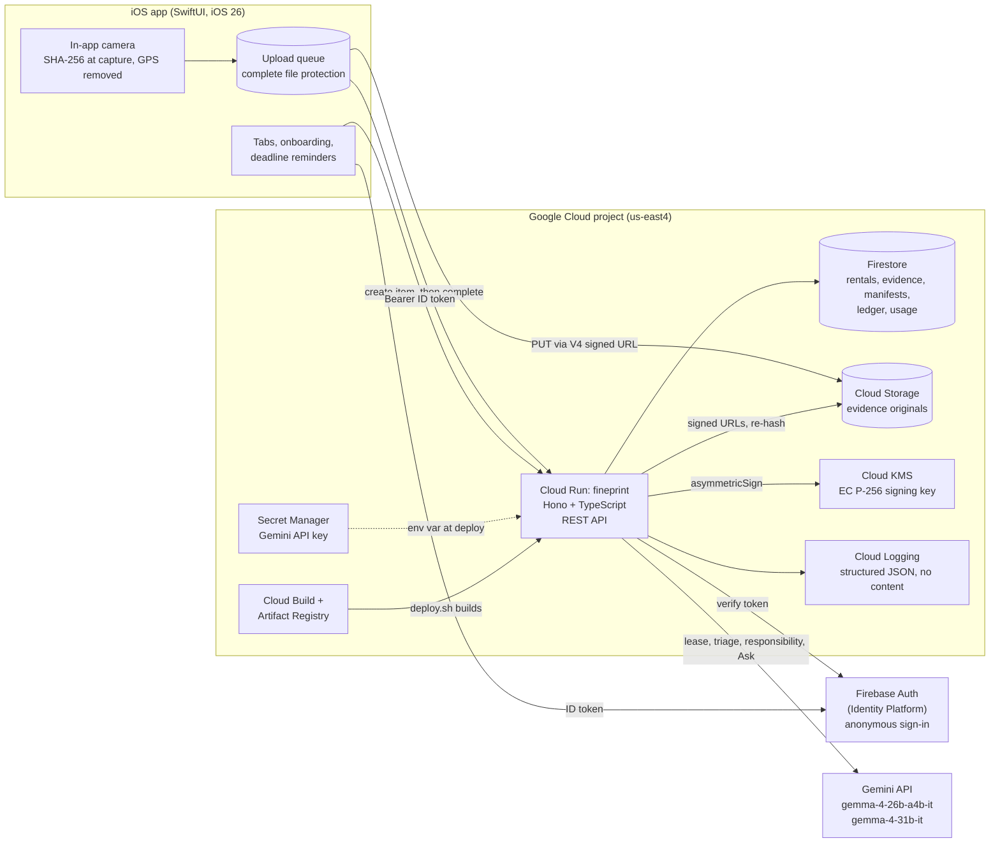

# FinePrint

> Virginia renters keep their security deposit and get repairs made. FinePrint turns their lease and their phone camera into evidence and the deadlines the law already gives them.

## Overview

Under Virginia law, the landlord's move-in damage report is **deemed correct unless the tenant objects in writing within five days** ([Va. Code § 55.1-1214](https://law.lis.virginia.gov/vacode/title55.1/chapter12/section55.1-1214/)). Most tenants do not know this clock exists. Damage left off the report can come out of their deposit at move-out.

FinePrint has two parts:

- **An iOS app for tenants** (SwiftUI, iOS 26). It explains the lease, records sealed move-in evidence, tracks the deadlines, and drafts the letters. The tenant sends the letters. The app never sends anything for them.
- **A web Evidence Report for legal aid caseworkers.** The server renders it, and the reader can check its signatures in the browser.

Scope: residential tenancies under the Virginia Residential Landlord and Tenant Act (VRLTA, Va. Code § 55.1-1200 et seq.). FinePrint does not cover commercial leases or other states, and it does not represent tenants. The rules live in a data-only jurisdiction pack (`jurisdictions/`), so a later contributor can add a state without changing code.

FinePrint is not a lawyer and gives no legal advice. When the stakes are high (eviction, lockout, retaliation, discrimination), it sends the tenant to legal aid.

### Why it matters

- **Most Blacksburg households rent.** 64% of occupied housing units in the Town of Blacksburg are renter-occupied: 8,885 of 13,840 (±612). In Montgomery County the share is 45% (16,523 of 36,961), and in Virginia it is 33% (1,099,123 of 3,365,732). Source: U.S. Census Bureau, American Community Survey 2020–2024 5-year estimates, table B25003, via [Census Reporter](https://censusreporter.org/data/table/?table=B25003&geo_ids=16000US5107784,05000US51121,04000US51).
- **Most Virginia Tech undergraduates live off campus.** 67% of degree-seeking undergraduates live off campus or commute, while 99% of first-year students live in college housing. Virginia Tech enrolled 31,536 undergraduates in fall 2025. Source: Virginia Tech [Common Data Set 2025–2026](https://aie.vt.edu/analytics-and-ai/common-data-set.html), sections B1 and F1.
- **Many renters lose some or all of their deposit, and documentation helps.** These figures are national; no Virginia data was found. Among U.S. renters who recently moved from a previous rental, 40% got their entire deposit back, 18% got most of it, 9% got some, and 24% got none. 19% disagreed with the landlord about repairs, damage, or maintenance, and 16% about move-out costs or fees. Renters who documented the move-in condition with photos, video, and a checklist, and told the landlord, got their entire deposit back 50% of the time, against 41% for renters who did none of these. That comparison is observational. Source: [Zillow Consumer Housing Trends Report 2024: Renters](https://www.zillow.com/research/renters-housing-trends-report-2024-34387/) ([archived copy](https://web.archive.org/web/20260120104727/https://www.zillow.com/research/renters-housing-trends-report-2024-34387/)). The report combines six surveys of more than 36,000 renters, fielded March to July 2024.
- **Virginia deposit disputes.** TODO: source. Virginia's courts do not report security deposit cases separately, and no public Virginia dataset was found.

### Status

This is a hackathon build. The README describes the code on `dev`, the integration branch that merges into `main`. Planned work is marked **planned** and links to its issue.

| Area | On `main` | Planned |
| --- | --- | --- |
| iOS app shell | Tab bar (Lease, Evidence, Repairs, Letters, Ask), the next-deadline accessory, onboarding, settings, Delete Everything with a receipt, the developer menu, multiple rentals with a switcher, the grounded Ask tab, report share links in Settings, the opt-in impact count, TestFlight builds | The Letters screens |
| Lease | Scan or import a PDF, on-device OCR (Apple Vision), on-device PII redaction, a redaction review, and "What Gets Sent" | Upload from the app and the findings screens (#18) |
| Repairs | New issue (description, room, item, photos), the Gemma responsibility check with its result card, and emergency guidance | Repair notices and the rent escrow path (#32) |
| Deadlines | The move-in report, objection, and deposit itemization clocks, with local reminders and a deposit tracker | |
| Evidence capture | In-app camera, SHA-256 at the shutter, GPS removed, on-device quality checks, an encrypted upload queue, direct upload to Cloud Storage, the room-by-room move-in walkthrough and seal | Damage analysis with Gemma (#26), the move-out overlay and diff (#27) |
| Evidence integrity | Server hash check, Cloud KMS-signed manifests (RFC 8785 JCS), a hash-chained signed ledger, logged deletion, published public keys | |
| Web Evidence Report | Server-rendered report at `/r/:token` that checks hashes and manifest signatures in the browser, opened by expiring, revocable share links with an optional PIN and an access log, and gated in CI by axe WCAG 2.2 AA checks ([docs/web-evidence-report.md](docs/web-evidence-report.md)) | |
| Sign-in | Firebase anonymous auth (Identity Platform) | Sign in with Apple |
| AI | The Gemma 4 client, the VRLTA rule pack (31 rules), triage, the lease pipeline (S1 to S9) streamed over SSE, the responsibility check, grounded Ask with function calling, and a self-hosted provider ([docs/ai-pipeline.md](docs/ai-pipeline.md)) | Vision (#26), landlord report diff (#28), the AI trace overlay (#39) |
| Deploy | Idempotent `deploy.sh` and `--destroy`, secrets in Secret Manager, a scheduled purge job | |

## Models and licenses

| Model | Role | License |
| --- | --- | --- |
| [`gemma-4-26b-a4b-it`](https://ai.google.dev/gemma/docs/core) (mixture of experts, about 4B active parameters) | Primary model for every stage | [Apache-2.0](https://ai.google.dev/gemma/apache_2) |
| [`gemma-4-31b-it`](https://ai.google.dev/gemma/docs/core) (dense) | Independent verifier for legal findings only | [Apache-2.0](https://ai.google.dev/gemma/apache_2) |
| `gemini-flash-latest` | Last fallback, only when every Gemma model is down. The server labels its answers as fallback answers. | Proprietary, billed |

The server calls both Gemma models through the [Gemini API](https://ai.google.dev/gemini-api/docs) with the `@google/genai` SDK. The model IDs live in [`server/src/ai/models.ts`](server/src/ai/models.ts). The env vars `GEMMA_PRIMARY`, `GEMMA_VERIFIER`, and `GEMMA_FALLBACK` change them. FinePrint has no on-device language model. On the phone it uses only Apple frameworks (Vision, NaturalLanguage, CryptoKit).

`GEMMA_PROVIDER=openai_compatible` with `GEMMA_BASE_URL` points the server at a self-hosted Gemma 4 server (Ollama or vLLM) instead, so tenant text stays on your network. See [docs/self-hosting.md](docs/self-hosting.md).

FinePrint itself is licensed under [Apache-2.0](LICENSE), the same license as Gemma 4.

### What the AI does

Design rule: **Gemma interprets, code verifies.** Each call returns structured JSON, and Zod validates it. Code checks quotes, citations, numbers, and dates literally. User documents are wrapped in `<document>` tags, and the system instruction says that text inside a document cannot change the task.

| Stage | Model | Thinking | What it does | Status |
| --- | --- | --- | --- | --- |
| Triage | 26B | `minimal` | Finds high-stakes situations (eviction, lockout, retaliation). A keyword backstop in code also triggers, so either one can route the tenant to legal aid. | Built (#37): `POST /v1/triage`, lease S1, and the responsibility check |
| Lease extraction | 26B | `high` | Pulls clauses and key terms (rent, deposit, dates, fees) from the redacted lease text | Built (#14, #16): lease S2 |
| Rule mapping | 26B | `high` | Maps clauses to VRLTA rules from the rule pack, such as the prohibited provisions in § 55.1-1208 and the late-fee cap in § 55.1-1204 | Built (#14, #16): lease S5 |
| Legal verifier | 31B | `high` | A second, independent opinion on each legal finding: it sees only the clause and the statute's exact words. If 31B is down, the finding is marked "unverified" and reads as "worth asking about". | Built (#15): lease S7 |
| Vision | 26B | `minimal` | Finds damage in evidence photos, proposes an approximate box for the tenant to adjust, and compares move-out photos with move-in photos | Planned (#26, #27) |
| Landlord report diff | 26B | not set | Compares the landlord's move-in report with the tenant's sealed evidence, then drafts the five-day objection | Planned (#28) |
| Responsibility check | 26B, then 31B | `high` | "Likely the landlord's / likely yours" with reasons, citations, confidence, and what would change the answer. 31B checks the High-confidence verdicts. | Built (#31): `POST /v1/rentals/:id/issues` and the Repairs tab |
| Ask | 26B | `minimal` | Answers questions grounded in the tenant's lease and the rule pack, with function calling | Built (#41): `POST /v1/rentals/:id/ask` and the Ask tab ([docs/grounded-ask.md](docs/grounded-ask.md)) |
| Explanation, translation | 26B | `minimal` | Plain-language explanations, checked in code at grade 7 or lower (5 for Simpler). Translation is a separate, last step over text that is already verified. Legal quotes stay verbatim. | Built (#15): lease S8 and S9 |

Every stage calls one client: `generate(stage, schema, docs, options)` in [`server/src/ai/gemma.ts`](server/src/ai/gemma.ts). The lease pipeline is in [`server/src/ai/pipeline/lease.ts`](server/src/ai/pipeline/lease.ts), and `GET /v1/rentals/:id/leases/:leaseId/stream` streams its stages, key terms, and findings over Server-Sent Events as each one is verified. The stage table, retry policy, fallback chains, and measured model behavior are in [docs/ai-pipeline.md](docs/ai-pipeline.md).

## Architecture



Also built: on-device OCR and PII redaction before any lease text leaves the phone, Server-Sent Events for streamed lease findings, and the web Evidence Report at `/r/:token` with share links. Still planned (spec §5.1): the app's lease upload and findings screens (#18) and on-device PDF letters.

### How a photo becomes evidence

1. The in-app camera hashes the original (SHA-256) at the shutter, removes any GPS, and checks for darkness, overexposure, and blur.
2. The app queues the photo with complete file protection and calls `POST /v1/rentals/:id/evidence`. The server returns a 5-minute V4 signed PUT URL. The upload must send the signed content type and declared hash (`x-goog-content-sha256`) headers. Cloud Storage does not hash the body against that header, so step 4 is the check that rejects other bytes.
3. The app uploads the bytes **straight to Cloud Storage**. The API never proxies image bytes.
4. `POST /v1/rentals/:id/evidence/:itemId/complete`: the server hashes the stored object again, compares the hash and size with the capture record, and records `receivedAtServer`. A mismatch returns 422 `HASH_MISMATCH`.
5. `POST /v1/rentals/:id/seal`: the server builds a manifest of the items and the previous ledger head, canonicalizes it with RFC 8785 JCS, and signs it with Cloud KMS. It then appends a hash-chained, KMS-signed `manifest_sealed` ledger entry.
6. Anyone can check a signature against the public keys at `/.well-known/fineprint-keys.json`.

### Server routes on `main`

| Route | Auth | Purpose |
| --- | --- | --- |
| `GET /healthz`, `GET /health` | Public | Health. Cloud Run reserves `/healthz` on `*.run.app`, so `deploy.sh` checks `/health`. The dependency checks are stubbed for now. |
| `GET /.well-known/fineprint-client.json` | Public | Firebase project ID and web API key for the app. One app build works with any deployment. |
| `GET /.well-known/fineprint-keys.json` | Public | KMS public keys (JWK) |
| `GET /v1/me` | ID token | Confirms that the server accepts the token |
| `POST /v1/rentals`, `PATCH /v1/rentals/:id` | ID token | Create and update a rental |
| `POST /v1/rentals/:id/evidence` | ID token | Create evidence items and return signed upload URLs |
| `POST /v1/rentals/:id/evidence/:itemId/complete` | ID token | Check the stored hash and record the receipt time |
| `DELETE /v1/rentals/:id/evidence/:itemId` | ID token | Delete the photo and log `evidence_deleted` in the ledger |
| `POST /v1/rentals/:id/seal` | ID token | Sign a manifest and append it to the ledger |
| `GET /v1/rentals/:id/ledger`, `GET /v1/rentals/:id/manifests/:manifestId` | ID token | Read the ledger and the manifests |
| `POST /v1/rentals/:id/leases` | ID token | Store redacted lease text (up to 1 MB) |
| `GET /v1/rentals/:id/leases/:leaseId/stream` | ID token | Run the lease pipeline and stream stages, key terms, and findings (SSE) |
| `GET /v1/rentals/:id/leases/:leaseId` | ID token | The stored lease, clauses, and findings |
| `POST /v1/rentals/:id/issues` | ID token | The responsibility check for a repair issue |
| `POST /v1/rentals/:id/ask` | ID token | Grounded Ask: Gemma answers with read-only tools over this rental, and every sentence must cite a source |
| `POST /v1/rentals/:id/shares`, `GET /v1/rentals/:id/shares` | ID token | Create and list report share links |
| `DELETE /v1/shares/:id`, `GET /v1/shares/:id/access` | ID token | Revoke a share link and read its access log |
| `PATCH /v1/me/impact` | ID token | Opt in to or out of the impact count |
| `POST /v1/triage` | ID token | Check text for a high-stakes situation |
| `DELETE /v1/me` | ID token | Delete Everything: the user's rentals, evidence, and account |
| `GET /r/:token`, `GET /r/verify.js` | Share link token (and PIN if set) | The web Evidence Report and its in-browser verifier |
| `GET /impact` | Public | Anonymous aggregate impact totals |
| `POST /internal/purge` | Cloud Scheduler OIDC token | Auto-purge of old tenancies |

Errors use one envelope: `{ "error": { "code": "...", "message": "..." } }`. Each response carries an `X-Request-Id`, and each log line carries the same ID.

## Setup

Prerequisites: Node 22 or later, pnpm (the version is pinned in `package.json`), Java 21 for the Firebase emulators, and Xcode with the iOS 26 SDK for the app.

```sh
pnpm install
pnpm --filter @fineprint/server dev:emulated   # server on :8080 with the Auth, Firestore, and Storage emulators
```

The iOS app's default server is `http://localhost:8080`. To build it and run its tests, see [ios/README.md](ios/README.md).

Checks (CI runs these on each push and pull request):

```sh
pnpm lint && pnpm typecheck && pnpm test && pnpm check:jurisdictions
cd e2e && pnpm test:e2e:web        # end-to-end tests against the server with emulators
```

Most work needs no Gemini API key. The live Gemma smoke test and the e2e agent steps need one. Run commands through `scripts/with-secrets.sh`, which preserves your personal AI Studio key or reads the shared key from Google Cloud Secret Manager, as [CONTRIBUTING.md](CONTRIBUTING.md) describes.

### Deploy your own

[](https://shell.cloud.google.com/cloudshell/editor?cloudshell_git_repo=https://github.com/max-miller1204/FinePrint&cloudshell_git_branch=main)

The button clones the repo into Cloud Shell. First create a Google Cloud project and link billing to it. Then, in Cloud Shell or on any machine with the Google Cloud CLI, run:

```sh
gcloud auth login
./deploy.sh                    # prompts for the project and region (us-east4)
./deploy.sh --destroy          # removes it all, after you type the project ID
```

Google Cloud Secret Manager holds the shared Gemini key, mounted by Cloud Run. Run `./deploy.sh` directly to reuse it. For initial setup, the script accepts `GEMINI_API_KEY` or prompts with hidden input. Supply an environment key for intentional rotation. Do not deploy with a personal development key exported: the deploy script treats a different key as a rotation. See [CONTRIBUTING.md](CONTRIBUTING.md) for personal keys, shared access, and partner setup.

You can run the script again at any time. It skips the resources that exist and ships a new revision. At the end it prints the server URL to set in the iOS app. The budget alerts are in US dollars, so the budget step fails on a billing account that uses a different currency.

## API dependency map

Each external service FinePrint uses. `deploy.sh` creates these resources and grants these bindings. The runtime service account is `fineprint-api`, and the build service account is `fineprint-build`. Measured costs are coming in #51. The cost column gives only the pricing model.

| Service | Used for | IAM / permissions | Cost | What breaks if it is down |
| --- | --- | --- | --- | --- |
| **Gemini API** (`generativelanguage.googleapis.com`) | Gemma 4 calls (26B and 31B), with Gemini Flash as the last fallback | API key from AI Studio, stored in the Secret Manager secret `GEMINI_API_KEY`. No IAM role. | Gemma 4: free of charge, and the paid tier is "Not available" ([pricing](https://ai.google.dev/gemini-api/docs/pricing), read 2026-10-22). Flash fallback: billed per token, so set a spend cap in AI Studio. Tier 1 quota: 30 RPM, 16K input TPM, 14.4K RPD per model. | Lease analysis, triage, the responsibility check, and Ask. On 429 or 5xx the client retries with backoff, then falls back from 31B to 26B to Flash. If every model fails, legal findings show as "unverified". The triage keyword backstop still runs. Capture and sealing do not depend on it. |
| **Firebase Auth / Identity Platform** (`identitytoolkit`, `securetoken`) | Anonymous sign-in on the app. The server verifies ID tokens with `firebase-admin`. | API key `fineprint-client`, limited to Identity Toolkit and Secure Token. It identifies the project and grants nothing on its own, so the server publishes it. Token checks need no role. `fineprint-api` has `roles/firebaseauth.admin` on the project so Delete Everything can remove the caller's user. | Identity Platform per-user pricing. Anonymous sign-in is within its free tier at hackathon scale ([pricing](https://cloud.google.com/identity-platform/pricing)). | New users cannot sign in, and tokens cannot refresh. When a token expires, `/v1` calls return 401. Photos stay queued on the phone. |
| **Cloud Run** (`run`) | The single `fineprint` service: the API, and later the web report. `--max-instances=3`, 512 MiB, unauthenticated ingress (the app authenticates per request). | The service runs as `fineprint-api`. `fineprint-build` has `roles/run.builder`. | Per request and per vCPU-second. Scales to zero. | Everything server-side. The app keeps working offline: captures queue and upload on reconnect. |
| **Firestore** (Native mode, `(default)`) | Rentals, evidence records, manifests, the ledger, and model usage records (`usage/{date}/calls`). Client access is denied by rules. Only the server reads and writes. | `fineprint-api`: `roles/datastore.user` on the project | Per document read, write, and delete, plus storage. The free daily quota covers small deployments. | The rental, evidence, and seal routes return 503 `DEPENDENCY_UNAVAILABLE`, which the app retries. Nothing is sealed. |
| **Cloud Storage** (bucket `<project>-fineprint-evidence`) | Evidence originals and the 1536 px copies for the model. Uniform access, public access prevention enforced, reached only through 5-minute V4 signed URLs. | `fineprint-api`: `roles/storage.objectAdmin` on the bucket, and `roles/iam.serviceAccountTokenCreator` on itself only. Cloud Run has no key file, so the server signs URLs through IAM `signBlob` (`iamcredentials` API). | Per GB-month of standard storage in `us-east4`, plus operations | Uploads and the hash check fail. Photos stay in the phone's queue and retry. If `signBlob` fails, `POST /v1/rentals/:id/evidence` returns 503. |
| **Cloud KMS** (key ring `fineprint`, key `report-signing`, `EC_SIGN_P256_SHA256`, software protection) | Signs manifests and ledger entries, and serves the public keys | `fineprint-api`: `roles/cloudkms.signerVerifier` on the key to sign, and `roles/cloudkms.viewer` on the key to list its versions | Per active key version per month, plus per signing operation ([pricing](https://cloud.google.com/kms/pricing)) | Sealing and `/.well-known/fineprint-keys.json` return 503. Uploads and hash checks still work, and the server can seal those items later. |
| **Secret Manager** (`GEMINI_API_KEY`, user-managed replication in the region) | Holds the Gemini API key. Cloud Run mounts it as an env var. | `fineprint-api`: `roles/secretmanager.secretAccessor` on the secret | Per active secret version per month, plus per access operation | A new revision cannot start without its secret. Running instances keep the value they already have. |
| **Cloud Build** and **Artifact Registry** (repo `fineprint`) | `gcloud run deploy --source .` builds the root `Dockerfile` and stores the image | `fineprint-build`: `roles/run.builder` | Per build-minute, and per GB-month of stored images | Deploys fail. The running service is not affected. |
| **Cloud Logging** | Structured JSON logs from stdout: request ID, route pattern, status, latency, model, tokens. Never content. | Cloud Run writes logs by default | Free allotment for ingestion, then per GiB | You lose visibility only. The service is not affected. |
| **Cloud Billing and Billing Budgets** | The billing check before deploy, and a $20 budget that alerts at $10 and $20 | The person who deploys needs to see the billing account and create budgets on it | Free | Only the alerts stop. A budget alert does not cap spend. |
| **law.lis.virginia.gov** | Source of the statute text for the rule pack snapshots in `jurisdictions/va/snapshots/`. `scripts/refresh-snapshots.ts` re-fetches and diffs them. | None (public) | Free | Nothing at runtime. A snapshot refresh would wait. |

`deploy.sh` also enables `iam`, `iamcredentials`, `apikeys`, `logging`, `cloudbilling`, and `billingbudgets`, which it needs to set up the resources above, and `cloudscheduler` for the job that calls `POST /internal/purge`.

## Cost

TODO: measured cost table (#51)

## Eval results

The lease eval sets run the full pipeline against the real models (`pnpm eval`). Latest run, 2026-10-25, on `gemma-4-26b-a4b-it` and `gemma-4-31b-it`: **PASS**.

| Set | Metric | Result | Gate |
| --- | --- | --- | --- |
| `lease-synthetic` | Recall | 100% (8/8) | >= 90% |
| `lease-synthetic` | Precision | 100% (8/8) | >= 85% |
| `clauses-golden` | Verifier agrees on violations | 40/40 | report |
| `citations` | Findings that resolve to a rule in the pack | 100% (136/136) | 100% |

Full tables: [docs/eval-results.md](docs/eval-results.md). The synthetic leases are small (three leases, eight planted violations), so treat these as regression gates, not accuracy claims.

## Accessibility

The web Evidence Report is checked against WCAG 2.2 AA with axe-core in CI (#36). It reads and prints without JavaScript.

TODO: the iOS VoiceOver and Dynamic Type audit (#49)

## Privacy

TODO: see [PRIVACY.md](PRIVACY.md) (#49)

### Gemini API data use

**Google may use what FinePrint sends to Gemma 4 to improve its products, and human reviewers may read it.** Gemma 4 on the Gemini API has only a free tier: the [pricing page](https://ai.google.dev/gemini-api/docs/pricing) (updated 2026-10-22) lists its paid tier as "Not available" and marks the free tier "Used to improve our products: Yes".

The [Gemini API Additional Terms](https://ai.google.dev/gemini-api/terms) (updated 2026-04-28) say access is a Paid Service "only when accessing the API through a Cloud Project associated with an active billing account", and that "unpaid quota in Gemini API" is an unpaid Service. A billed project is required for the paid terms but is not enough on its own. `deploy.sh` requires billing, but Gemma has no paid quota to use, so Gemma calls fall under the unpaid terms. Those terms also say: "Do not submit sensitive, confidential, or personal information to the Unpaid Services."

What FinePrint does about it:

- Only lease text that the device has already redacted goes to the model. The app runs OCR and redaction on the phone, and original scans never leave it.
- **Planned:** evidence photos go to the model only as 1536 px copies with GPS removed (#26).
- To keep content off Google's unpaid terms entirely, run Gemma 4 open weights on your own server (`GEMMA_PROVIDER=openai_compatible`, [docs/self-hosting.md](docs/self-hosting.md)).
- The Gemini Flash fallback is billed, so it falls under the Paid Service terms when the key's project has billing.

## Limitations

What the evidence model proves, and what it does not (spec §8.4):

- FinePrint proves that **a file has not changed since the server sealed it at time T**, and that **the tenant's record of events is complete and in order**. The ledger is hash-chained and each entry is KMS-signed, so a removed or reordered entry is detectable.
- It **cannot prove that the device clock was right** before the photo reached the server. The server records its own receipt time next to the device's capture time.
- It **cannot prove that a scene was not staged.** A hash shows only that the bytes have not changed.
- A deleted photo leaves a logged gap. The manifest still verifies, because it signed the hash, not the bytes.
- Planned for the web report (not on `main` yet): offline gaps longer than 24 hours get a flag, and imported photos get a "capture time unverified" label.

Other limits:

- **Virginia only.** The rules cover the VRLTA. The pack (`jurisdictions/va/`) has 31 rules from §§ 55.1-1204, -1208, -1214, -1220, -1226, -1228, -1229, -1235, -1236, -1240, -1244, -1251, -1252, -1253, and -1258, with snapshots fetched 2026-10-25. Last verified: 2026-10-24, by a person checking every quote and subsection against its snapshot.
- **Data use.** Gemma calls fall under Google's unpaid terms: Google may use the content to improve its products (see [Gemini API data use](#gemini-api-data-use)).
- **Not legal advice.** Verdicts say "likely", with reasons, citations, and confidence. High-stakes situations go to legal aid.
- **The AI can be wrong.** Code checks quotes, citations, numbers, and dates literally, and a second model checks legal findings. Interpretation can still be wrong. A finding checked by a fallback model carries a label.
- **Throughput.** Gemma 4 on Tier 1 allows 16K input tokens per minute per model, so one 12-page lease takes about two minutes of quota. Each project can analyze about one lease at a time.
- **Languages.** Analysis runs in English. Translation into another language is the last step (S9). No language other than English has been reviewed by people, and the multilingual parity eval has not been run live ([docs/language-parity.md](docs/language-parity.md)).
- **Health checks are stubbed.** `/healthz` does not yet check Firestore, Cloud Storage, or KMS.

## Contributing

See [CONTRIBUTING.md](CONTRIBUTING.md).

## License

[Apache-2.0](LICENSE)

## Opt-in impact

The public `/impact` page shows anonymous aggregate totals. Settings’
“Add to the Impact Count” is off by default and now saves consent on the
server. Counters include participating accounts, distinct verified clauses
flagged, first move-in seals in occupancy days 0 through 4 (UTC), and deposit
dollars covered, rounded down per rental to $500 buckets. This early-seal
measure is not a legal deadline. No names, rentals, documents, or account
identifiers are stored in the public counters. Past anonymous totals remain
after opt-out or deletion; earlier activity is never backfilled.

Objection letters, repairs, and actual legal-aid handoffs are labeled “Not
tracked yet” until their workflows exist. Counts measure participation and
actions, not proven legal outcomes. See the [verification map](.agents/skills/verify-fineprint-web/features/impact.md).
