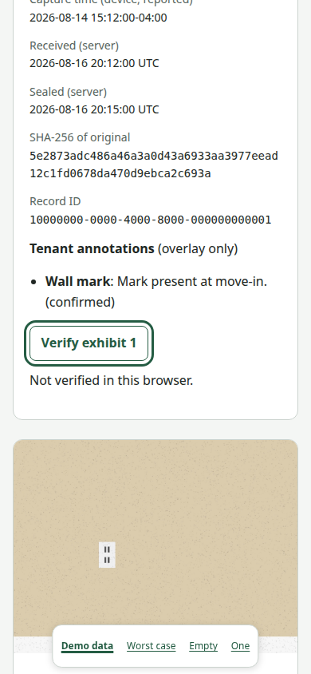
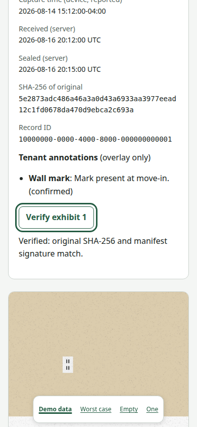

# Issue #34 verification evidence

Synthetic emulator fixtures, Linux Chromium, 2026-10-25. The signer is the
server's ephemeral local P-256 key using the production raw ES256 format,
published through `/.well-known/fineprint-keys.json`. No deployed KMS service
or production storage bucket was exercised.

| Before verification | After Enter |
| --- | --- |
|  |  |

Same `/r/fixture` exhibit, light mode, 390 x 844 viewport, keyboard only.
Focus remains on the native button and the live status announces the result.
The test also reaches Verify report by Tab and Enter, with an incomplete
result for the deleted photo. [Stress capture](phone-worst-dark-large-text.png):
320 x 720, dark mode, reduced motion, 200% text, worst-case fixture.
No horizontal overflow or clipped button labels was found. Controls wrap,
retain 44px minimum targets and stay usable with long mixed-script content.

Final smoke and affected-feature gate, one run, exit **0**:

```text
cd e2e
pnpm exec e2e run tests/web/smoke.e2e.ts tests/web/report.e2e.ts tests/web/report-verify.e2e.ts --config e2e.issue34.config.ts --target web --output .e2e/proof/issue-34-final --trace on --no-cache --retries 0

run 01a172c0-f0f5-7965-a412-567e63de5298
Test Files  3 passed (3)
Tests       12 passed (12)
Duration    16.84s
```

The temporary config reused the checked-in web target with emulator ports
19099 (Auth), 18090 (Firestore), and 19190 (Storage). Default ports were
occupied by another worktree. The override is retained locally at
`e2e/.e2e/proof/issue-34-final/isolated.config.ts` and the Firebase config at
`e2e/.e2e/issue34.firebase.json`. With default ports free, omit `--config`
to repeat the same gate using the checked-in config.

All six verification tests ran, covering successful originals, tampered
bytes, signatures, canonical JSON and hashes, exhibit binding, unknown keys,
duplicate manifests, retry, expired URLs, network failure, missing WebCrypto,
missing/deleted originals, no preview, blocked scripts, empty reports and
phone stress data. The five existing report tests cover SSR, keyboard,
320px/390px/1440px layouts and actual tagged print/PDF output.

The full web suite also passed before the final report-verdict reset fix:
run `01a172bf-1f9f-7b89-a507-bb2eaea85143`, 12 files, 45 passed, 2 skipped,
exit 0. The skips are existing live-model lease tests requiring an API key.
A subsequent full-suite attempt could not boot because the other worktree
had acquired the default emulator ports; the final isolated gate above
covers every affected feature plus smoke on the final source.

Other checks on the final implementation: server TypeScript passed,
445 unit tests passed, lint passed with warnings, `git diff --check` passed.
Logs include request IDs and route patterns without raw share tokens.

Real-hardware testing was not done. No Mac or iOS simulator was used.
Phone safe areas, sticky hover, touch feel and Safari printing still need
hardware checks. HTTPS and CORS GET from the report origin are required for
cross-origin signed originals; #35's loader owns authorization and URLs.
No open product decisions. Ledger-history verification and axe CI are outside
this issue's manifest-and-original verification scope.
